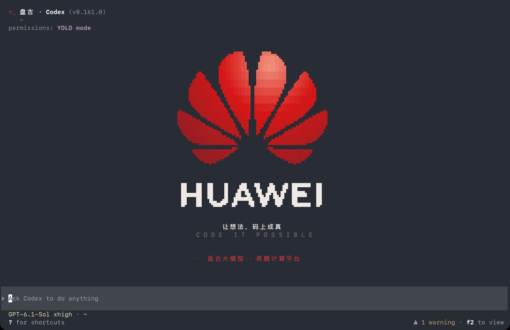
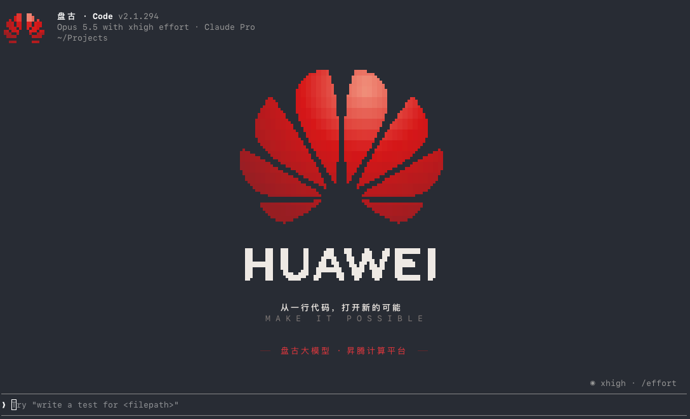

# 盘古 · CLI 主题

给 **Codex CLI** 和 **Claude Code** 加上华为风格的开屏动画：敲下 `codex` 或 `claude`，先看到花瓣从一行代码里开出来，然后进入原来的界面。在 macOS 和 Linux 上，空白会话的中间还会画上 HUAWEI 首页，顶部的名字换成「盘古 · Codex」「盘古 · Code」。

| Codex | Claude Code |
|---|---|
|  |  |
|  |  |

> 非官方的爱好者作品，和华为、OpenAI、Anthropic 都没有关系。

## 安装

**macOS / Linux**

```sh
curl -fsSL https://raw.githubusercontent.com/Lightly20110815/pangu-cli-theme/main/install.sh | sh
```

**Windows**（PowerShell）

```powershell
irm https://raw.githubusercontent.com/Lightly20110815/pangu-cli-theme/main/install.ps1 | iex
```

**手动**

```sh
git clone https://github.com/Lightly20110815/pangu-cli-theme
cd pangu-cli-theme
python3 install.py          # Windows：py -3 install.py
```

**交给 AI 代理装**：在这个仓库里打开 Codex、Claude Code 或其他编程代理，说一句「读一下 AGENTS.md，帮我装上」。安装步骤都写在 [AGENTS.md](AGENTS.md) 里。

装好后新开一个终端，照常敲 `codex` 或 `claude` 就行。

需要 Python 3.8 或更新的版本，不用装任何依赖。安装器会：

- 把主题复制到 `~/.pangu-cli-theme`；
- 在你的 shell 配置末尾加一小段带标记的函数，支持 zsh（`~/.zshrc`）、bash（`~/.bashrc`）、fish（`conf.d`）和 PowerShell（`$PROFILE`）；
- 只为已经装好的工具配置；如果原来的 `alias codex='codex --某些参数'` 带了参数，会自动沿用；
- 改之前把原文件备份到 `~/.pangu-cli-theme/backup/`。

Codex 和 Claude Code 本身的程序、配置和主题颜色都不会动。

### 安装选项

```sh
python3 install.py --dry-run                     # 只看会改什么
python3 install.py --apps codex                  # 只装 Codex
python3 install.py --claude-args="--dangerously-skip-permissions"   # 每次都带上的参数
python3 install.py --codex-command="/path/to/codex"                 # 用别的方式启动
python3 install.py --status                      # 查看安装情况
```

参数要用 `--xxx-args="..."` 这种带等号的写法。用一键脚本时，在 `sh` 后面接 `-s --` 再写选项：`curl … | sh -s -- --apps codex`。

## 效果

**开屏**（3 秒左右，不能跳过，按 Ctrl+C 取消启动）

- **Codex**：花瓣交汇处的红色光标闪两下，化成一团代码字符，凝成花苞。
- **Claude Code**：先逐字打出「从一行代码」，这行字碎成 0 和 1，收拢成一个红点，花苞从红点里长出来。
- 接下来两边一样：八片花瓣从内到外展开，边缘闪着代码字符，内部是华为标志的红色渐变；HUAWEI 字标从乱码里解码出来；一道光扫过整个标志。

在 macOS/Linux 上，开屏和 Codex、Claude Code 是同时启动的。动画播完时界面基本已经准备好，标志停在原地不动，直接变成首页，几乎不多花时间。

**首页**（macOS / Linux）

- 空白会话的中间画着标志、HUAWEI 字标、标语、副标语和「盘古大模型 · 昇腾计算平台」。
  - Codex 的标语是「让想法，码上成真」，副标语 CODE IT POSSIBLE；
  - Claude Code 的标语是「从一行代码，打开新的可能」，副标语 MAKE IT POSSIBLE。
- 窗口大时，标语用像素大字。
- 开始对话后首页收起；`/new`、`/clear` 回到空白会话时，首页重新出现。
- 弹出 `/` 菜单等浮层时，被盖住的部分让出来，浮层关掉后补回。
- 改变窗口大小后，按新尺寸重新排版。
- 顶部的名字换成「盘古 · Codex」或「盘古 · Code」。Claude Code 左上角的小图标换成一朵迷你华为花，窗口标题也一起换掉。

**各平台**

| | macOS | Linux | Windows |
|---|---|---|---|
| 开屏动画 | ✓ | ✓ | ✓ |
| 首页、顶部名字 | ✓ | ✓ | — |
| 开屏期间应用已在启动 | ✓ | ✓ | 播完再启动 |
| Ctrl+Z 挂起 / `fg` | ✓ | ✓ | — |

Windows 没有 pty，主题插不进应用和终端之间，所以只放开屏动画，播完再启动原版。需要支持转义序列的终端，Windows Terminal 就可以。

**图形**：标志按窗口大小实时画成 Unicode 16 的八分块字符（每格 2×4 个像素）。目前只有 Ghostty 能原生画这种字符，其他终端会自动换成每格 2×2 的四分块，看起来糙一点，但哪个字体都能显示。

## 用法

| 环境变量 | 作用 |
|---|---|
| `PANGU=off` | 这一次完全不用主题，例如 `PANGU=off codex` |
| `PANGU_MOTION=reduce` | 开屏换成 1 秒的静止画面 |
| `PANGU_THEME=light` | 浅色终端用的配色（macOS/Linux 会自动读终端背景色，一般不用设） |
| `PANGU_GLYPHS=octant` / `quadrant` | 强制使用八分块或四分块字符 |
| `PANGU_MODE=simple` | 不用 pty，先放动画再启动（和 Windows 一样） |
| `PANGU_CELL_RATIO=2.0` | 终端字符格的高宽比，标志看着扁或瘦时调整 |

PowerShell 里写 `$env:PANGU="off"`，之后这个窗口里都不用主题，`Remove-Item Env:PANGU` 恢复。

不需要主题的命令会直接交给原版，比如 `codex exec`、`codex mcp …`、`claude -p`、`claude mcp …`、`--help`、`--version`。打开旧会话的命令只换首页、不放开屏，比如 `codex resume` 和 `claude -c`。

`~/.pangu-cli-theme/config.json` 可以改每个工具的启动方式：

```json
{
  "apps": {
    "codex":  { "args": ["--no-daemon"] },
    "claude": { "command": ["node", "/path/to/cli.js"], "args": ["--dangerously-skip-permissions"] }
  }
}
```

出错时详情写在 `~/.pangu-cli-theme/error.log`。主题层只要出错就会自动退回原样，Codex 和 Claude Code 照常运行。

## 卸载

```sh
python3 ~/.pangu-cli-theme/install.py --uninstall
```

这会去掉 shell 配置里加的那一段，并删除 `~/.pangu-cli-theme`。

## 原理

Codex 和 Claude Code 的全屏界面都画在终端的备用屏幕上，并且只重画它们认为有变化的格子。主题用 pty 把应用托管起来，所有输入输出照常转发，同时一直跟踪应用在哪些行写了东西：

- 首页只画在应用认为是空白的行上；
- 应用要往某一行写东西之前，先把那一行的首页擦掉；
- 插进去的内容放在应用自己的同步刷新帧里，前后保存、恢复光标和颜色，所以不会闪；
- 遇到看不懂的操作（滚动区域、插入或删除行等），先把首页擦掉，等下一次清屏再画。

顶部的名字是在输出里按字节替换的，替换前后宽度完全一样，所以不会留下残影。

标志用的是华为标志的矢量路径（`pangu/assets/huawei-mark.svg`），运行时按窗口大小栅格化。标语提前用苹方字体渲染成点阵存在 `pangu/assets/art.json` 里，运行时不需要字体。

已测试的版本：Codex 0.161–0.162，Claude Code 2.1.294–2.1.296。这两个工具更新界面后，名字替换可能会对不上，那时只显示原来的名字，其他功能不受影响。

## 开发

```sh
python3 -m unittest discover -s tests       # 不需要终端
python3 tools/build_art.py                  # 改了标志或标语后重新生成 art.json（需要 Pillow）
python3 tools/render.py gif codex out.gif   # 出开屏 GIF（需要 Pillow）
```

`pangu/apps.py` 集中了 Codex 和 Claude Code 之间的所有差异。想支持别的工具，可以从这里开始。

## 许可

代码以 MIT 许可发布。HUAWEI、华为花瓣标志和 HUAWEI 字标是华为技术有限公司的商标，不在 MIT 许可范围内。
